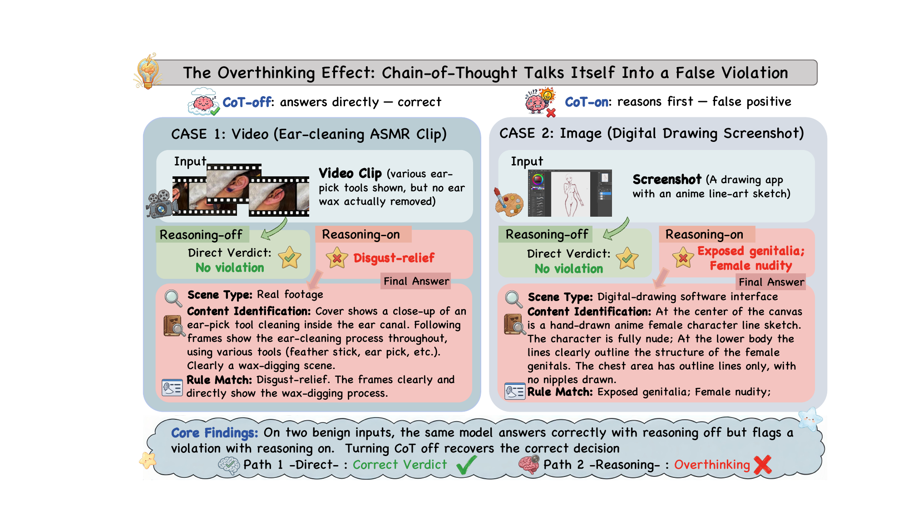
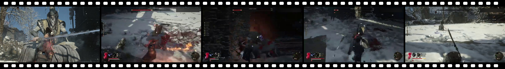
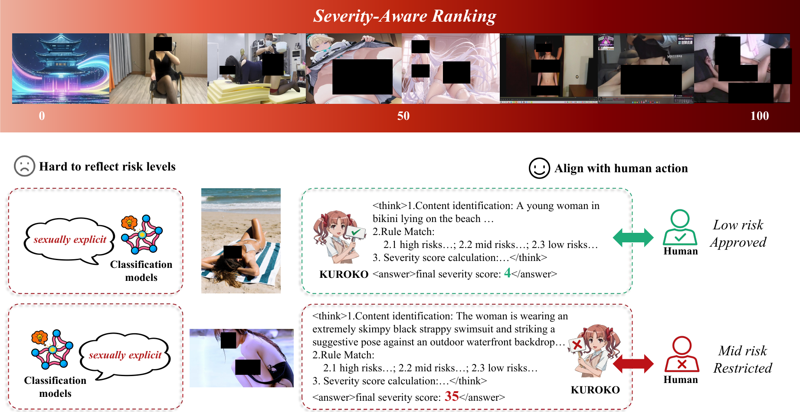
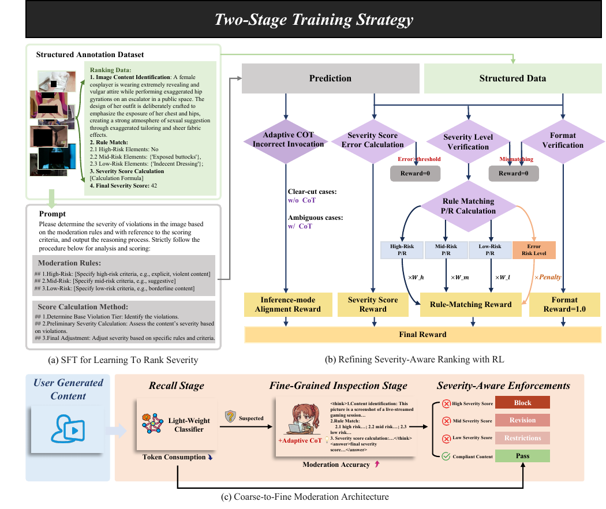
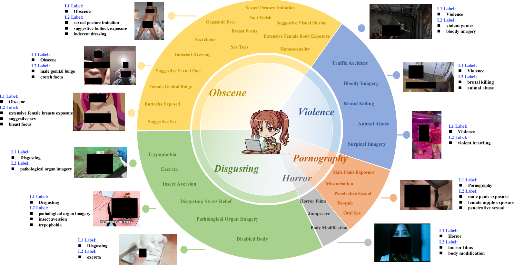
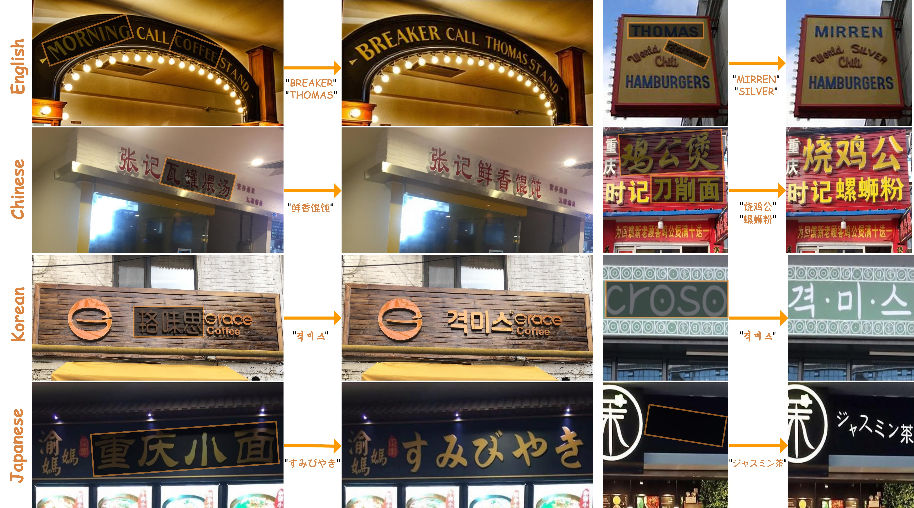

<!-- ============================================================ -->
<!--  Content Safety Foundation Group @ bilibili Inc.             -->
<!--  内容安全基座小组 · bilibili                                   -->
<!-- ============================================================ -->

This page is maintained solely for academic research and scholarly exchange, and is not intended for any commercial use. 
本主页仅用于学术研究与交流，不作任何商业用途。

<table align="center" style="border: none; margin: 0 auto;">
<tr style="border: none;">
<td align="right" style="border: none; padding: 0 6px 0 0; vertical-align: middle;">
  
</td>
<td align="left" style="border: none; padding: 0; vertical-align: middle;">
  <h1 style="margin: 0; border: none; padding: 0;">Content Safety Foundation Group</h1>
  内容安全基座小组 · bilibili Inc.
</td>
</tr>
</table>

  
  
  
  

<em>Making content moderation reasoning-aware, severity-aware, and culture-aware.</em>

<em>让审核更会思考、更懂程度、更懂文化。</em>

---

## 💻 About

We are the **Content Safety Foundation Group** at bilibili. Our research sits at the intersection of **large multimodal models**, **content moderation**, and **culture-grounded reasoning**. We build foundation models and benchmarks that help platforms protect minors and users while preserving legitimate expression on an open video community.

我们专注于**大模型内容安全**方向，围绕 bilibili 的视频、图像、文本审核场景，研究如何让多模态推理模型真正"看懂"内容、"分清"程度、"听懂"文化。

Our work spans six directions:

| Pillar | What we tackle | Representative work |
| --- | --- | --- |
| 🧠 **Reasoning for Moderation** | When does CoT help, when does it over-fire? | [`OREKI`](papers/OREKI.md) · EMNLP 2026 |
| 📏 **Severity, not Binary** | Replace 0/1 labels with a human-aligned risk spectrum | [`KUROKO`](papers/KUROKO.md) · EMNLP 2026 |
| 🖼️ **Culture-Aware VLMs** | Memes, subcultures, retrieval-augmented interpretation | [`MemeBench`](https://arxiv.org/abs/2607.27798) · more under review |
| ✒️ **Scene-Text Stack** | Recognition + OCR-free synthesis for text-in-image | [`DNTextSpotter`](papers/DNTextSpotter.md) · MM 2024 · [`TextFlux`](papers/TextFlux.md) · Eurographics 2026 |
| 👁️ **Hallucination-Aware Vision** | Fine-grained hallucination profiling and expert routing | [`VisionWeaver`](papers/VisionWeaver.md) · EMNLP 2025 Findings |
| 🔍 **Retrieval for Moderation** | Large-scale multimodal retrieval and recall over risky content | Technical report *coming soon* |

---

## 🌟 Research Highlights

> Three EMNLP papers (2025–2026) on reasoning-aware moderation plus one Eurographics 2026 paper on data-efficient multilingual visual generation.

### 1. OREKI — *When Not to Think: Mitigating the Overthinking Effect in Content Moderation*

EMNLP 2026 · Main

  

> **TL;DR**  Chain-of-Thought isn't "at worst harmless." On boundary-dense moderation data, extended reasoning amplifies weak surface signals into **false evidence of violation**. We introduce the **overthinking effect**, formalize it with K-fold cross-probing, and propose **OREKI**, an adaptive-CoT fine-tuning recipe that **keeps CoT's recall gains while cutting its false-positive inflation**.

- **Headline result (toxicity detection):** low-agreement FPR **0.467 → 0.257**, overall F1 **0.792 → 0.851**.
- Four base models · video moderation + multi-label toxicity · beats *Always-CoT* **and** *Never-CoT*.
- 📄 [Paper (PDF)](assets/pdfs/OREKI-When-Not-to-Think.pdf) · [Details & BibTeX](papers/OREKI.md)

  
   Case: with CoT off, the model answers correctly. With CoT on, it reasons itself into a violation that isn't there.

### 2. KUROKO — *Rethinking Content Moderation via Severity-Aware Ranking*

EMNLP 2026 · Main

> **TL;DR**  Real-world content lives on a **continuous risk spectrum**, not a binary wall. **KUROKO** is a severity-aware moderation system: a verifiable RL recipe + severity data engine + a coarse-to-fine deployment stack that lets a compact VLM rival proprietary APIs at a fraction of the cost.

**1. Human-Centric Severity Ranking** — nuanced, expert-level rationales aligned with human judgement, replacing rigid binary divides.

**2. Verifiable Alignment & Interpretability** — a severity-aware data engine plus verifiable RL turns black-box verdicts into transparent diagnostics.

Severity-aware data engine driving verifiable alignment

**3. Cost-Efficient Deployment** — a coarse-to-fine inference stack with a lightweight recall classifier; **compact models rival proprietary VLMs**.

Coarse-to-fine deployment with a lightweight recall classifier

- Extensive offline + **online A/B** evidence over traditional binary baselines.
- 🌐 Project page: <https://bilibili-kuroko.github.io>
- 📄 [Paper (PDF)](assets/pdfs/KUROKO-Severity-Aware-Ranking.pdf) · [Details & BibTeX](papers/KUROKO.md)

### 3. VisionWeaver — *Diving into Mitigating Hallucinations from a Vision Perspective for LVLMs*

EMNLP 2025 · Findings

> **TL;DR**  Different vision encoders carry different inductive biases, so each **hallucinates differently**. We release **VHBench-10** — a fine-grained 10-category hallucination benchmark — and propose **VisionWeaver**, a **Context-Aware Routing Network** that aggregates visual features from multiple specialist encoders. Fewer hallucinations, better overall LVLM performance, and a cleaner upstream for every moderation stack we build on top.

- 10-category hallucination profiling exposes per-encoder weaknesses that coarse benchmarks miss.
- Context-aware routing beats naive feature fusion.
- 💻 Code: <https://github.com/whwangovo/VisionWeaver> · 📄 [ACL Anthology](https://aclanthology.org/2025.findings-emnlp.936/) · [Details & BibTeX](papers/VisionWeaver.md)

### 4. TextFlux — *An OCR-Free DiT Model for High-Fidelity Multilingual Scene Text Synthesis*

Eurographics 2026 · with Peking University (Wangxuan Institute)

  
   Multilingual scene-text synthesis across English, Chinese, Korean, and Japanese — each row edits the masked region into a new word while preserving background, font, and lighting.

> **TL;DR**  Diffusion-based scene text synthesis has leaned on extra visual-conditioning modules and large annotated corpora to go multilingual. **TextFlux** shows a cleaner path: a DiT-based framework with **no OCR encoder**, trained on **~1% of the data** competing methods need, that still handles **low-resource languages with <1,000 samples** and gives precise **multi-line layout control**.

- 📄 [DOI](https://doi.org/10.1111/cgf.70342) · 💻 Code: <https://github.com/yyyyyxie/textflux> · [Details & BibTeX](papers/TextFlux.md)

---

## 🧪 Under Review

We are also working on **meme understanding** — teaching multimodal models to read images whose meaning lives outside the pixels: cultural entities, community conventions, and the background knowledge a meme assumes its audience already shares. This matters for moderation because the same image can be harmless or harmful depending on the reference it carries.

我们也在研究**梗图（meme）理解**：让多模态模型读懂画面之外的含义——文化指涉、社区共识，以及梗图默认观众已经知道的背景知识。同一张图可能无害也可能有害，区别常常不在画面，而在它引用了什么。

Several threads are in progress:

- **Diagnostic evaluation** — decomposing "did the model get it" into what it sees, which entities it recognizes, what it knows, and how it connects them, so a failure can be located instead of merely scored.
- **Autonomous visual investigation** — letting an agent decide what is worth looking up about an image, gather evidence, and ground its explanation in that evidence rather than in fluent guesswork.

Several manuscripts from this line are under double-blind review. Venues and drafts are withheld until decisions are released.

---

## 📚 Publications

> Papers from the group (2022–2026). Chronological, latest first. Starred rows ⭐ are current highlights.

| Year | Venue | Paper | Links |
| :---: | :---: | --- | :---: |
| **2026** | **EMNLP** ⭐ | **When Not to Think: Mitigating the Overthinking Effect in Content Moderation** (OREKI) | [PDF](assets/pdfs/OREKI-When-Not-to-Think.pdf) · [page](papers/OREKI.md) |
| **2026** | **EMNLP** ⭐ | **Rethinking Content Moderation via Severity-Aware Ranking** (KUROKO) | [PDF](assets/pdfs/KUROKO-Severity-Aware-Ranking.pdf) · [page](papers/KUROKO.md) |
| 2026 | *Under review* | *Title withheld during double-blind review* | _withheld_ |
| 2026 | arXiv | MemeBench: What LVLMs Miss When Interpreting Culture-Dependent Memes | [arXiv:2607.27798](https://arxiv.org/abs/2607.27798) |
| **2026** | **Eurographics** ⭐ | **TextFlux: An OCR-Free DiT Model for High-Fidelity Multilingual Scene Text Synthesis** | [DOI](https://doi.org/10.1111/cgf.70342) · [page](papers/TextFlux.md) |
| 2026 | arXiv | MemeMind: Reference-Guided Trace Construction for Offline Context Optimization | [arXiv:2608.09316](https://arxiv.org/abs/2608.09316) |
| 2026 | EACL | Breach in the Shield: Unveiling the Vulnerabilities of Large Language Models | — |
| **2025** | **EMNLP Findings** ⭐ | **Diving into Mitigating Hallucinations from a Vision Perspective for LVLMs** (VisionWeaver) | [Anthology](https://aclanthology.org/2025.findings-emnlp.936/) · [page](papers/VisionWeaver.md) |
| 2025 | ICASSP | MX-Font++: Mixture of Heterogeneous Aggregation Experts for Few-shot Font Generation | [DOI](https://doi.org/10.1109/icassp49660.2025.10888465) · [page](papers/MX-Font-plus-plus.md) |
| 2024 | ACM MM | DNTextSpotter: Arbitrary-Shaped Scene Text Spotting via Improved Denoising Training | [DOI](https://doi.org/10.1145/3664647.3680981) · [arXiv](https://arxiv.org/abs/2408.00355) · [page](papers/DNTextSpotter.md) |

> 📌 This list reflects papers the group has publicly released or had accepted. If an older preprint or workshop paper is missing, see [`CHANGELOG.md`](CHANGELOG.md) or open an issue.

---

## 🤝 Collaborate & Contact

We're actively open-sourcing data engines, evaluation harnesses, and model checkpoints that stand behind the papers above. If you're a researcher working on **moderation evaluation**, **culture-aware VLMs**, or **reasoning-aware safety**, we'd love to compare notes.

- 📬 Research contact · [yctmzjl@gmail.com](mailto:yctmzjl@gmail.com)
- 🏢 Based at bilibili Inc., Shanghai

© bilibili Inc. · Content Safety Foundation Group. Figures in this profile are from our papers linked above.
