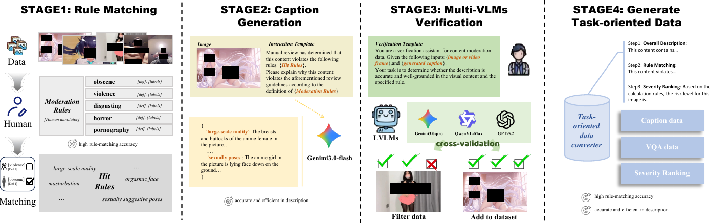
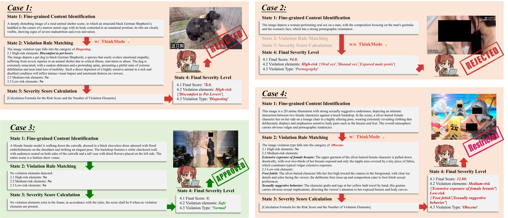

# KUROKO — Rethinking Content Moderation via Severity-Aware Ranking

> **Venue** · EMNLP 2026 (Main)  
> **PDF** · [`assets/pdfs/KUROKO-Severity-Aware-Ranking.pdf`](../assets/pdfs/KUROKO-Severity-Aware-Ranking.pdf)

**Authors** · Yang Ou\*, Jielei Zhang\*†, Yu Dai, Zian Yang, Run Yang, Xiang Li, Weihang Wang, Xueqian Zhao, Peiyi Li, Longwen Gao — *Bilibili Inc.*  
<sub>\* equal contribution · † corresponding</sub>

---

## Hero figure

<p align="center">
  
</p>

## Why this paper

Online video content moderation is critical for protecting minors, but violations are increasingly **implicit and context-dependent**. A swimwear shot is innocuous in a vlog and high-risk with suggestive posing. Binary systems cannot represent this continuity, and that mismatch directly causes **over-penalization of benign-but-sensitive content** and **misses on deeply implicit violations**.

**KUROKO** is a behind-the-scenes assistant that pushes the industry from binary classification to a **severity-aware ranking** paradigm.

## Three contributions

1. **Human-Centric Severity Ranking** · Replace rigid binary divides with a continuous risk spectrum. KUROKO emits expert-level rationales closely aligned with human judgement.
2. **Verifiable Alignment & Interpretability** · A severity-aware data engine plus a verifiable RL recipe turns black-box verdicts into transparent, actionable diagnostics.
3. **Cost-Efficient Deployment** · A coarse-to-fine inference architecture with a lightweight recall classifier lets compact models rival proprietary VLMs at a fraction of their scale.

## Pipeline at a glance

<p align="center">
  
  &nbsp;
  
</p>

<p align="center">
  
  &nbsp;
  
</p>

## Results

- Beats traditional binary baselines on **offline** evaluation.
- Competitive with leading commercial APIs at a fraction of their scale.
- **Online A/B** on Bilibili: more human-confirmed enforcement actions than the previous binary system.

## BibTeX

```bibtex
@inproceedings{ou2026kuroko,
  title     = {Rethinking Content Moderation via Severity-Aware Ranking},
  author    = {Ou, Yang and Zhang, Jielei and Dai, Yu and Yang, Zian and Yang, Run
               and Li, Xiang and Wang, Weihang and Zhao, Xueqian
               and Li, Peiyi and Gao, Longwen},
  booktitle = {Proceedings of the 2026 Conference on Empirical Methods in Natural Language Processing (EMNLP)},
  year      = {2026},
  publisher = {Association for Computational Linguistics}
}
```
